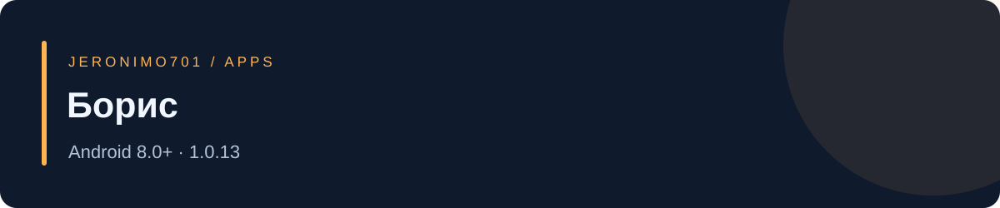
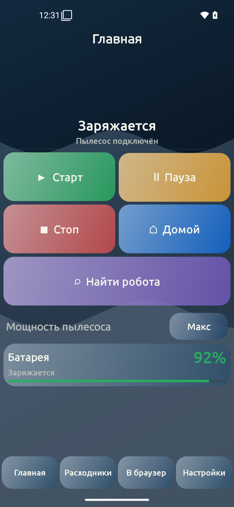

# Борис

Локальный Android-пульт для Roborock с Valetudo-совместимым API.

**[Скачать 1.0.13](https://github.com/jeronimo701/Boris/releases/download/v1.0.13/Boris-1.0.13-debug.apk) · [Описание релиза](https://github.com/jeronimo701/Boris/releases/tag/v1.0.13) · [Все выпуски](https://github.com/jeronimo701/Boris/releases)**

| Платформа | Версия | Файл |
| --- | --- | --- |
| Android 8.0+ | 1.0.13 | `Boris-1.0.13-debug.apk` |


## Скриншоты

Борис 1.0.13, Android 15. Демонстрация настоящего интерфейса приложения с локальным тестовым сервером: статус и 92% батареи — тестовые данные. Физический пылесос не подключался, команды ему не отправлялись.

<p> </p>


## Возможности

**Поиск устройства.** Проверка последнего адреса и устройств текущей локальной подсети через API.

**Управление уборкой.** Команды основной панели, мощность, зональная уборка и переход по координатам.

**Расходники.** Показ счётчиков из API устройства.

**Веб-панель.** Открытие штатного интерфейса пылесоса в браузере.

## Установка

Установите APK и подключите телефон к локальной сети пылесоса. Устройство должно предоставлять совместимый API `/api/current_status` и `/api/consumable_status`. Обычная заводская прошивка Roborock без такого API не гарантирует работу.

## Статус выпуска

APK 1.0.13 подписан debug-сертификатом, versionCode 14. Ранее сборка и lint прошли: 0 ошибок, 11 предупреждений. На физическом телефоне и пылесосе эта публикация не проверялась. При другой подписи уже установленного приложения обновление поверх него может быть недоступно.

Контрольные суммы и сопроводительные лицензии находятся в файлах релиза.

## Сборка из исходников

```powershell
.\gradlew.bat :app:assembleDebug :app:lintDebug --no-daemon
```

JDK 17, Android SDK 35. Настройте путь SDK через локальный `local.properties` или `ANDROID_HOME`. Подробности: [сборка и проверка](BUILD-RELEASE.ru.md).

## Лицензия

Собственный код распространяется на условиях [Jeronimo701 Personal Use 1.0](LICENSE.txt). Публичный доступ к репозиторию не отменяет условий использования. Область действия: [LICENSE-SCOPE.md](LICENSE-SCOPE.md). Условия сторонних компонентов: [THIRD-PARTY.md](THIRD-PARTY.md).
